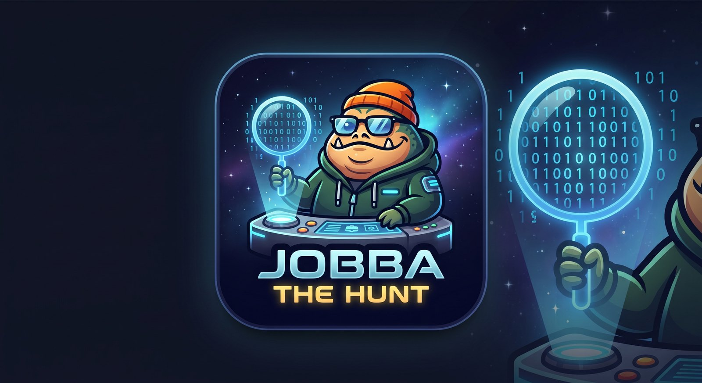

# Jobba the Hunt

A React Native job-hunting app that pulls postings from eight public job
boards into one feed, tracks what you've applied to, and puts your
interviews on your calendar.

It does **not** auto-apply. "Engage" opens the original posting so you send a
real application yourself. Auto-apply bots produce exactly the
fill-in-the-blanks letters that ATS systems and recruiters filter out — the
app's job is organisation, not automation.

## What it does

- **Bounty Board** — one merged feed from eight sources, searchable, sortable
  by freshness, pay or employer, filterable by source, remote and pay.
- **Bounty Log** — status per application (Sighted → Transmitted → In Pursuit
  → Audience → Bounty Claimed / Carbonite), stored on the device.
- **Interviews** — scheduling an Audience writes a calendar event with
  reminders a day and an hour ahead, and deletes it if the interview falls
  through.
- **Marks** — watch specific employers' Greenhouse boards, not just whoever
  happens to be on a job board.
- **Dossier** — your details, used to draft a cover letter per posting. The
  draft leaves bracketed gaps where the specific parts belong, on purpose.

## Sources

All public, key-free, and used within their terms. Nothing is scraped, and
LinkedIn and Indeed are deliberately untouched — their terms forbid it and
the penalty is a permanent account ban.

| Source | Paging | Notes |
| --- | --- | --- |
| [Remotive](https://remotive.com) | one-shot | server-side keyword search |
| [Arbeitnow](https://www.arbeitnow.com) | `?page=` | EU-heavy, rate-limits |
| [Remote OK](https://remoteok.com) | one-shot | attribution required |
| [Jobicy](https://jobicy.com) | one-shot | full descriptions, salary |
| [The Muse](https://www.themuse.com) | `?page=` | not remote-only |
| [Himalayas](https://himalayas.app) | `?offset=` | 20 per page |
| [We Work Remotely](https://weworkremotely.com) | one-shot | RSS, not JSON |
| [Greenhouse](https://boards-api.greenhouse.io) | one-shot | per employer |

Remote OK's API terms require naming them as a source and linking back, so
their postings link to the Remote OK page rather than the employer's apply
URL, and the feed carries a visible Sources credit. Their logo is a
registered trademark and is not used.

## Running it

```sh
npm install
npx expo start        # phone via Expo Go
npx expo start --web  # browser
```

Everything works in Expo Go **except** calendar sync — `expo-calendar` has no
native module there. The interview date still saves to the tracker and the
app says which of the two happened. For real calendar events:

```sh
npx expo run:ios     # or run:android
```

### Web

```sh
npx expo export --platform web --output-dir dist
```

Two platform differences, both deliberate:

- **Himalayas is unavailable on the web build.** Every other board sends
  `Access-Control-Allow-Origin: *`; Himalayas sends no CORS header, so a
  browser blocks the response before the app sees it. Proxying it would mean
  running a backend, which this project doesn't have. The source picker shows
  7 of 7 rather than pretending the eighth is merely broken.
- **The opening crawl is skipped on the web.** A 14-second title card reads
  as character on a phone you opened deliberately, and as a blank page on a
  URL you just landed on.

## Notes on the build

A few decisions that aren't obvious from the code:

- **Sources are queried in parallel.** One failing board degrades the feed
  instead of emptying it, and the loader names each board as it answers.
- **HTML arrives three different ways.** Some boards send real HTML, some
  send it escaped (`&lt;p&gt;`), some double-escaped. Entities are decoded
  before tags are stripped, repeatedly, or the markup reappears as visible
  text.
- **HTTP 429 is not an outage.** Arbeitnow rate-limits; that keeps the cursor
  alive and offers a retry rather than ending the feed.
- **Offline is not a source outage.** They used to report identically, which
  blamed the boards for the phone having no signal.
- **Keyword filters are two-tier.** Both the Star Wars detector and the
  gambling/adult filter split invented words from everyday ones, because
  "Force" is in Salesforce, "Republic" is in Czech Republic, and "sex"
  appears in every equal-opportunity statement ever written.
- **The feed is cached.** Launch shows the last scan immediately and
  re-sweeps behind it.

## Stack

React Native (Expo SDK 57), TypeScript, React Navigation, AsyncStorage,
expo-calendar, expo-clipboard. No backend — the app calls the public APIs
directly and stores everything on the device.

## Licence

MIT — see [LICENSE](LICENSE).
